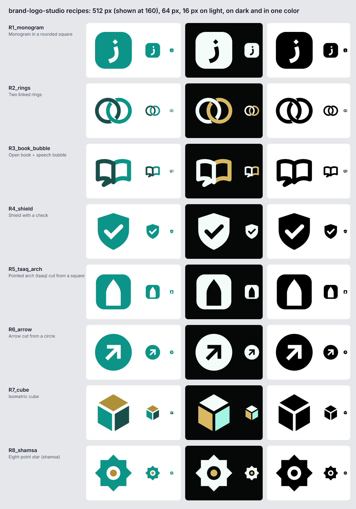

# Icon recipes

Eight geometric icons on a 100 × 100 grid (`scripts/lib/marks.mjs`). Every separation is a real cut-out, so each recipe survives one-color printing; colors come from the palette roles (`primary`, `ink`, `accent`, and their dark-background versions). Modes: `color`, `reversed` (for dark backgrounds), `mono-black`, `mono-white`.

| Id | Shape | Use for | Limits |
|---|---|---|---|
| `R1_monogram` | First letter cut out of a rounded square; optional accent-colored dot | Any name; the safest app icon and avatar | Needs a **static** font for the letter (variable fonts overlap contours and break the cut-out) — `vazirmatn-black` by default. Letters without dots get no accent dot |
| `R2_rings` | Two interlocked rings (two real cuts) | Partnership, payments, connection | Rings are common — make it yours with color and the wordmark. Thin at 16 px: favicons switch to the monogram |
| `R3_book_bubble` | Open book whose left page ends in a speech-bubble tail | Language schools, tutoring, reading | Stroke-based: weakest at 16 px — the kit then switches the favicons to a simplified monogram automatically and says so in kit-report.md |
| `R4_shield` | Shield with a cut-out check | Security, insurance, clinics, verification | Very common in security — keep the wordmark strong |
| `R5_taaq_arch` | Pointed Persian arch (taaq) cut from a square | Architecture, hospitality, culture | **Only when the subject is related.** Original shape, not a copy of a building |
| `R6_arrow` | Diagonal arrow cut from a circle | Logistics, growth, fintech, "go" | Arrows are generic; pair with a distinctive wordmark |
| `R7_cube` | Isometric cube, three faces with ≈ 6% gaps | Software, building blocks, storage | Three colors; in one color the gaps carry the form |
| `R8_shamsa` | Eight-point star (two squares) with an open center and an accent dot | Crafts, heritage, hospitality | **Only when the subject is related**, never as a generic "Iranian" sign |

How the decision table ranks them per industry: decision-table.md. The three directions use: A = the industry's container (R1/R4/R5), B = the industry's first symbol, C = R1 with the accent dot, echoing the wordmark.

## Adding a recipe
1. Draw on the 100-grid with absolute path commands; separations as cut-outs (`fill-rule="evenodd"`) or `<mask>`, never by color alone.
2. Use `paint(mode, colors, role, reversedRole)` for every fill.
3. Add it to `RECIPES` with `name`, `kind` (container/symbol), `use`.
4. Run `node scripts/selftest.mjs` — every recipe × mode must have no FAIL, pass the one-color check, and fit the maskable safe zone. Then look at the preview image by eye.

## Common mistakes
- Separating shapes only by color (the first shamsa draft: two overlapping squares — merged into a blob in one color; the selftest keeps it as a regression case).
- Gaps under 6% of the height (the first cube draft nearly disappeared into a solid hexagon at 16 px).
- Free-hand curves for organic shapes (animals, faces). Stay with geometry; recommend a human illustrator.
